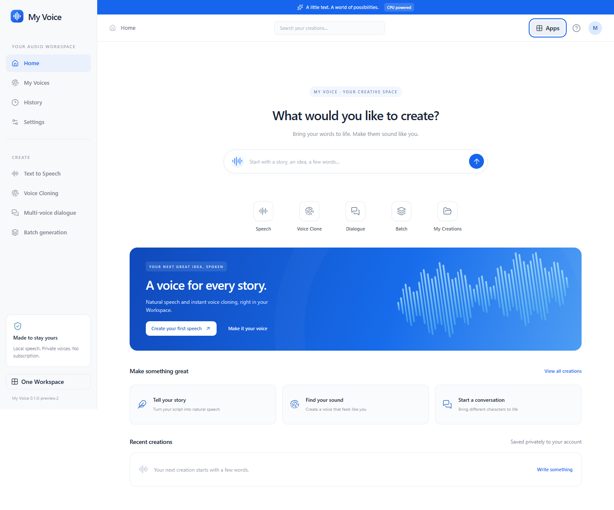

# My Voice

Your words, brought to life in One Workspace. Write a script, turn it into speech,
or create a private voice from a reference you are authorised to use.

My Voice takes inspiration from familiar audio tools, with original Workspace
branding, a quiet home screen, a focused script editor and a private voice library.
It runs on your Windows PC. No speech subscription or GPU is required.

- Generate English speech with the small, CPU-only Pocket TTS presets.
- Create reusable voices with the open MOSS TTS Nano ONNX engine.
- Edit sentences, assign voices to dialogue segments, and regenerate one segment.
- Import TXT/Markdown, queue a batch, replay history and export WAV, MP3 or ZIP.
- Save a copy to your signed-in My Drive account. References stay private.
- Grant and revoke private use of your voices for other signed-in users.

## Get started

Install **My Voice** from the Creative & Development section of One Workspace
setup or Updates. Existing installations need Workspace112 for the new optional
app to appear in Updates. Open it from Apps, then visit Settings to install a model.
MOSS is the open cloning option; Pocket's ungated checkpoints provide preset
speech only. The launcher contains its CPU runtimes, **not the model weights**.
Model downloads are explicit, version pinned and checksum verified.

For standalone use, download the Windows package from
[Releases](https://github.com/oneworkspacestudio/my-voice/releases), extract it,
and run `MyVoice.exe`. Use the one-time setup link opened by the launcher to
create your local account. [Windows guide](INSTALL-WINDOWS.md).

Only clone a voice you own or have explicit permission to use. Keep a clear
3–30 second sample without music, clipping or long silences.

## Guides

[Architecture](ARCHITECTURE.md) · [API](docs/API.md) ·
[Model licences](MODEL-LICENSES.md) · [Native test report](TEST-REPORT-WINDOWS.md) ·
[Security](SECURITY.md) · [Changes](CHANGELOG.md)

This Windows preview exposes only the language codes explicitly listed upstream.
English has native acceptance coverage; other MOSS languages need your own review.
Hindi, noise removal, GPU engines, dubbing and voice agents are not included.
There is no claim of ElevenLabs feature parity, voice-quality superiority or
minimum-memory support on hardware that was not tested.

[Verified two-PC delivery receipt](docs/delivery-preview2.json).
